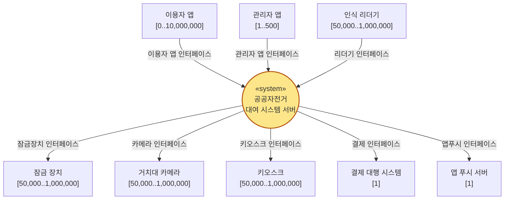

# System Overview (2페이지 이내)

## System Context Model

## System Context Diagram
<!--
<작성 방법>
개발 대상 시스템 자체와 외부의 대상(External Entity)을 명확하게 구분되어야 함.
External entity는 System의 개발 범위 외부의 대상이어야 함.
시스템과 직접적으로 상호 작용하는 모든 대상(사용자, 외부 시스템, 외부 장치 등)이 External entity로서 식별되어야 함.
추후 Use Case Model의 actor와 일치함.
Stakeholder 중에서 System과 직접적으로 interaction하는 사용자는 external entity에 해당될 수 있음.
External entity의 명칭이 구체적이며 해당 Entity의 역할을 의미함.
External entity의 Multiplicity가 명확히 명시되어야 한다 Multiplicity가 Business goal 측면에서 타당해야 함.
External interface
식별 기준: External entity와 시스템 간의 communication channel 별로 interface를 정의함.
방향
Client/Server 기준으로 방향 정의, 즉 데이터 흐름의 방향이 아니라 최초 제어의 방향임
Use case diagram의 association과 개념이 일치함
External Interface 명명
External entity 입장에서 명명; 시스템 관점에서의 기능/역할이 아니라
Interface의 목적/특성 등이 반영된 이름을 정의함.
-->

\* 화살표 방향은 최초 제어 방향(Client → Server), [ ]는 multiplicity. 원본: `diagrams/system_context.mmd`

| External Interface | 방향 | 목적 |
| --- | --- | --- |
| 이용자 앱 인터페이스 | 이용자 앱 → 시스템 | 대여소 조회, 예약, QR 대여 요청, 결제수단·미결제 요금 처리, 이용 이력 조회 |
| 관리자 앱 인터페이스 | 관리자 앱 → 시스템 | 대여소·장비 현황 관제, 원격 잠금/해제, 정비·재배치 관리, 기준값 설정 |
| 리더기 인터페이스 | 인식 리더기 → 시스템 | 자전거 식별 태그 인식 통보(반납·재배치 거치 시작) |
| 잠금장치 인터페이스 | 시스템 → 잠금 장치 | 잠금/해제 명령과 잠금 결과 확인 |
| 카메라 인터페이스 | 시스템 → 거치대 카메라 | 반납 자전거 촬영 요청과 영상 수신 |
| 키오스크 인터페이스 | 시스템 → 키오스크 | 대여·반납 결과와 거치대 상태 표시 |
| 결제 인터페이스 | 시스템 → 결제 대행 시스템 | 예약 수수료·이용 요금 결제 승인, 취소, 거래 결과 조회 |
| 앱푸시 인터페이스 | 시스템 → 앱 푸시 서버 | 이용자(반납 확정, 결제 실패, 예약 취소)와 관리자(장비 고장, 재배치 추천, 정비 필요)에게 알림 발송 요청 |

\* 장치 4종의 상태 수집은 각 장치 인터페이스 채널에 포함되며, 수집 방식(주기적 조회 또는 주기적 보고)은 Design Decision에서 결정한다.

## External Entity List
<!--
<작성 방법>
System Context Diagram의 각 External entity가 모두 나열되어야 함.
유형: 사용자, 외부 시스템, 외부 장치
설명
각 External entity의 시스템 관점에서의 역할을 기술함.
각 External entity에 대한 multiplicity 설정 및 Business goal에 부합되는 지에 대한 근거 제시 필요
사용자 유형: 단말기 환경 및 숙련도
외부 장치/시스템 유형: 가용성, 성능, 신뢰성 등 해당 EE의 품질 수준
-->

| Name | Kind | Description |
| --- | --- | --- |
| 이용자 앱 | 외부 시스템 (사용자 단말 앱) | **역할**: 자전거 이용자가 대여소 조회·예약, QR 스캔 대여, 결제수단 등록, 미결제 요금 해결을 요청하는 모바일 앱. 개발 범위 밖이며 시스템이 제공하는 인터페이스를 사용함 **Multiplicity**: 누적 0..10,000,000 계정 (현재 회원 500만 가정 × BG-18의 2배 확장), 출퇴근 피크 동시 접속 최대 100,000 **단말 환경/숙련도**: Android·iOS 스마트폰, LTE/5G·Wi-Fi(이동 중 통신 품질 변동). 연령대가 다양한 일반인으로 숙련도 편차가 큼 |
| 관리자 앱 | 외부 시스템 (관리자 단말 앱) | **역할**: 관제 관리자·정비 담당 관리자가 전국 대여소 현황 확인, 원격 잠금/해제, 정비·재배치 관리, 기준값 설정을 요청하는 앱 **Multiplicity**: 1..500 (관제센터 및 지자체별 관리자, 전국 약 250개 지자체 × 2명) **단말 환경/숙련도**: 업무용 태블릿·스마트폰, 사내망/LTE. 운영 교육을 받은 숙련 사용자 |
| 인식 리더기 | 외부 장치 | **역할**: 거치대에 꽂힌 자전거의 식별 태그를 읽어 시스템에 통보하여 반납 또는 재배치 거치를 시작시킴 **Multiplicity**: 50,000..1,000,000 (거치대당 1대, 5만 대여소 × 평균 10거치대 = 50만, BG-18 확장 고려 최대 100만) **품질 수준**: 태그 인식 후 0.5초 이내 통보. 대여소 네트워크 장애 시 일시적으로 통신이 끊길 수 있고, 재연결 후 같은 인식 이벤트가 중복 전달될 수 있음 |
| 잠금 장치 | 외부 장치 | **역할**: 시스템의 명령에 따라 거치대의 자전거를 잠그거나 풀고, 잠금 결과(잠금 확인)를 응답함 **Multiplicity**: 50,000..1,000,000 (거치대당 1대) **품질 수준**: 명령 수신 후 1초 이내 동작 및 결과 응답. 기계적 고장·자전거 미삽입으로 잠금 실패가 발생할 수 있음 |
| 거치대 카메라 | 외부 장치 | **역할**: 시스템의 요청에 따라 반납된 자전거를 촬영하여 영상을 전달함. 파손 판정은 시스템이 수행함 **Multiplicity**: 50,000..1,000,000 (거치대당 1대) **품질 수준**: 요청 후 2초 이내 촬영 영상(약 1MB) 전송. 야간·우천·역광 시 영상 품질이 낮아질 수 있음 |
| 키오스크 | 외부 장치 | **역할**: 거치대별 안내 화면으로, 시스템이 보낸 대여·반납 결과와 거치대 상태(대여 가능 / 정비 필요 / 빈 거치대)를 현장 이용자에게 표시함 **Multiplicity**: 50,000..1,000,000 (거치대당 1대) **품질 수준**: 표시 요청 후 0.5초 이내 출력 |
| 결제 대행 시스템 | 외부 시스템 | **역할**: 등록된 신용카드로 예약 수수료·이용 요금 결제를 승인·취소하고 거래 결과를 제공하는 PG사 시스템 **Multiplicity**: 1 (단일 PG사 계약) **품질 수준**: 가용성 99.9%(카드사별 정기 점검 시간 존재), 승인 응답 평균 1~3초, 거래 고유번호로 결과 조회 가능. 전자금융거래 안전성 기준 준수 |
| 앱 푸시 서버 | 외부 시스템 | **역할**: 시스템의 발송 요청을 받아 이용자 앱·관리자 앱에 푸시 알림을 전달하는 외부 서비스(예: FCM) **Multiplicity**: 1 **품질 수준**: 가용성 99.9%. 전달은 best-effort로 지연·누락될 수 있어 알림 수신을 보장하지 않음 |

## System Feature List
<!--
<작성 방법>
타당성
Feature 별로 관련된 business goal이 타당해야 함. 즉 해당 Feature는 Business goal 달성에 기여할 수 있어야 함.
Business goal을 달성하기 위하여 필요한 시스템이 제공할 feature가 누락되지 않고 나열한다. 즉 각 Business goal 별로 feature가 제시되어야 함.
Stakeholder 관점에서 이해/평가할 수 있는 수준으로 제시되어야 함. 즉, 구체적인 기능/품질을 의미하지 않음
Title
시스템의 기능/역할이 아니라 이해관계자의 Business Goal 수준으로 기술
시스템 수준이 아니라 비즈니스 수준에서 기술
Description
시스템이 어떤 역할을 함으로써 목표로 하는 Business goal을 달성시킬 수 있는 지를 서술함.
즉, 시스템이 제공할 핵심 역할을 통해서 어떻게 Business goal이 충족될 수 있는 지를 서술함.
개발자가 아니라 이해관계자가 이해할 수 있는 수준으로 서술함.
Importance
Feature의 Importance가 타당해야 함. 즉 관련 Business goal의 Stakeholder들이 동의해야 함.
-->

| ID | Title | Description | I | Related Business Goal ID |
| --- | --- | --- | --- | --- |
| SF-01 | 헛걸음 없는 대여소 찾기와 자전거 예약 | 이용자는 가려는 곳 주변 대여소의 실제 대여 가능 자전거 수와 빈 거치대 수를 미리 확인하고, 자전거를 예약해 15분 동안 확보할 수 있다. 도착했는데 자전거가 없거나 반납할 곳이 없는 일을 줄인다. | 상 | BG-01 |
| SF-02 | 기다림 없는 대여와 어디서나 반납 | 이용자는 QR 스캔만으로 곧바로 자전거를 빼고, 어느 대여소에든 꽂기만 하면 바로 반납이 확정되어 키오스크와 앱으로 확인받는다. 반납이 됐는지 불안해할 필요가 없다. | 상 | BG-01, BG-02 |
| SF-03 | 이용한 만큼만 정확한 자동 요금 정산 | 반납 확정 시점까지의 이용 시간으로 요금이 계산되고 예약 수수료를 뺀 금액이 등록 카드로 자동 결제된다. 한 번의 이용에 요금이 두 번 청구되거나 빠지는 일이 없고, 상담원은 이용·결제 이력으로 민원을 바로 확인한다. | 상 | BG-03, BG-09, BG-11, BG-12 |
| SF-04 | 미결제 요금 회수 | 자동 결제가 실패하면 이용자에게 즉시 알리고, 미결제 요금을 해결할 때까지 새 대여를 막아 운영기관의 미수금을 줄인다. | 중 | BG-09 |
| SF-05 | 반납 자전거 자동 안전 점검 | 반납된 자전거를 거치대 카메라로 자동 점검해 파손 자전거는 다음 이용자에게 대여되지 않도록 바로 막고, 정비 담당자에게 정비 대상으로 알린다. 정상 자전거를 잘못 막는 일도 줄인다. | 상 | BG-04, BG-07 |
| SF-06 | 대여소 장비 고장 즉시 인지 | 리더기, 잠금 장치, 카메라, 키오스크의 상태를 계속 확인하여 고장이 나면 민원이 들어오기 전에 관리자에게 알린다. | 상 | BG-05, BG-15 |
| SF-07 | 전국 대여소 한눈에 관제와 원격 조치 | 관리자는 전국 대여소의 거치대·자전거·빈 거치대 현황을 한 곳에서 보고, 현장에 가지 않고 잠금 장치를 원격으로 잠그거나 풀 수 있다. | 중 | BG-05, BG-06, BG-10 |
| SF-08 | 자전거 불균형 해소 지원 | 자전거가 부족하거나 거치대가 가득 찬 대여소를 주기적으로 찾아 관리자에게 추천하고, 재배치 중인 자전거는 요금 없이 도착 대여소에 바로 반영되어 재배치 기사의 사후 정정 작업이 없다. | 중 | BG-06, BG-08 |
| SF-09 | 이용자 개인정보와 결제 정보 보호 | 이용자의 개인정보와 카드 정보가 외부로 새지 않도록 보호하여 이용자는 안심하고 카드를 등록하고, 운영기관은 법적 책임과 신뢰 하락 위험을 줄인다. | 상 | BG-17 |
| SF-10 | 365일 24시간 끊김 없는 서비스 | 출퇴근 시간에 이용이 몰리거나 일부 서버·외부 시스템에 문제가 생겨도 대여·반납이 멈추지 않는다. | 상 | BG-15 |
| SF-11 | 대여소·회원 증가에도 같은 서비스 품질 | 대여소와 회원이 늘어나도 대여·반납 속도가 유지되고, 새 대여소는 등록만으로 서비스를 시작해 운영비 증가를 억제한다. | 중 | BG-18, BG-10 |
| SF-12 | 다양한 제조사 장비의 손쉬운 연동 | 장비 제조사가 바뀌거나 새 장비 모델이 들어와도 기존 서비스를 건드리지 않고 짧은 기간에 연동해 개발·시험 부담을 줄인다. | 중 | BG-13, BG-14, BG-16 |
| SF-13 | 요금 정책 변경의 신속한 반영 | 요금·예약 수수료 정책이 바뀌면 다른 기능에 영향 없이 빠르게 반영해 운영기관의 정책 변경 요구에 대응한다. | 하 | BG-16 |

\* I(Importance): 상 중 하로 구분

## Assumptions about the System
<!--
<작성 방법>
프로젝트 안내 자료에 명시되지 않았으나 시스템의 설계에서 필요한 여러 가정을 상세히 기술한다.
특히 기존 안내 자료에서 표현된 조건이나 기능 중 본 과제를 위해 수정하였거나 확장한 부분이 있다면 그에 대해 기술한다.
-->

**규모 및 부하**

1. 대여소는 5만 개, 대여소당 평균 10개의 거치대가 있으며 거치대마다 인식 리더기·잠금 장치·거치대 카메라·키오스크가 1대씩 설치된다(대여소 구성 그림 기준). 거치대는 총 50만 개이며, BG-18에 따라 최대 100만 개까지 확장될 수 있다고 가정한다.
2. 운영 자전거는 약 35만 대(거치대 수의 70%), 회원은 현재 500만 명(최대 1,000만 명)으로 가정한다.
3. 출퇴근 피크 시 대여·반납 요청은 각각 초당 최대 100건, 이용자 앱 동시 접속은 최대 10만으로 가정한다.

**외부 장치·시스템**

4. 장치는 종류별로 제조사가 달라도 운영기관이 정한 표준 연동 규격을 따르므로, 같은 종류의 장치는 하나의 External Entity로 다룬다.
5. 각 장치는 대여소 네트워크(유선 또는 LTE)를 통해 시스템에 직접 연결되며, 일시적인 통신 단절이 발생할 수 있다. 장치는 자가 진단 상태(정상/고장)를 제공한다. 상태 수집 방식(주기적 조회 또는 주기적 보고)은 설계에서 결정한다.
6. 거치대 카메라는 촬영만 하며 파손 판정은 시스템이 수행한다.
7. 결제 대행 시스템과 앱 푸시 서버는 일시적 장애는 있을 수 있으나 영구적으로 사용할 수 없는 상태가 되지는 않는다. 앱 푸시는 전달을 보장하지 않으므로 앱은 실행 시 최신 상태(반납 확정, 미결제 여부)를 조회해 보완한다.
8. 이용자 앱과 관리자 앱은 개발 범위 밖이며, 시스템은 앱이 사용할 인터페이스만 제공한다.

**업무 규칙 (안내 자료 해석·확장)**

9. 이용자는 동시에 1건만 예약 또는 대여할 수 있으며, 예약은 대여소의 특정 자전거를 지정한다.
10. 이용 요금에서 예약 수수료를 차감한 금액이 0원 미만이면 0원으로 처리하며 차액은 환불하지 않는다.
11. 반납 확정 시각은 잠금 장치의 잠금이 확인된 시각이다. 잠금에 실패하면 반납은 확정되지 않고 키오스크로 재거치를 안내한다.
12. 미결제 요금은 이용자가 앱에서 결제수단을 변경하거나 재결제를 요청하여 해결한다.
13. 파손 판정 자전거는 정비 완료 후 관리자가 관리자 앱에서 대여 가능 상태로 복귀시킨다. (안내 자료 확장)
14. "재배치 중" 자전거는 다른 이용자에게 대여할 수 없으며, 다른 대여소의 리더기에 인식되면 해당 대여소에 거치된 것으로 반영되고 "재배치 중" 상태가 해제된다.
15. 대여 가능 자전거 기준값은 관리자가 대여소별로 설정하며, 재배치 추천 검색은 10분 주기로 수행한다.
